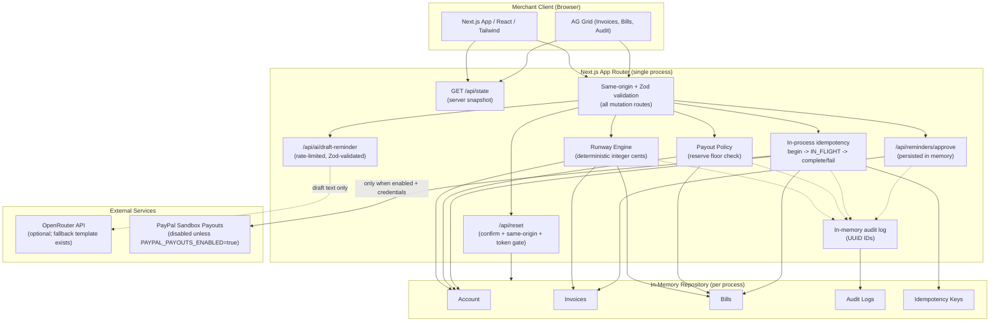
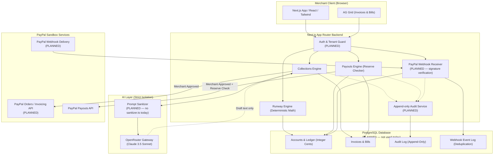

# System Architecture & Technical Design

## MerchOps AI — Financial Operations Copilot

> [!IMPORTANT]
> **Status: working single-process prototype.**
> This document deliberately distinguishes **IMPLEMENTED** (what the current code actually does) from **PLANNED / TARGET-STATE** (what a production deployment would add). The second diagram and the data-model section are target-state and must not be read as claims about the current repository.
>
> - **Runway Engine**: IMPLEMENTED & unit-tested (deterministic integer cents, deterministic `DEMO_AS_OF` clock).
> - **Collections Workflow**: IMPLEMENTED (OpenRouter reminder drafting with honest fallback, server-side reminder approval, payment simulation). No outbound email.
> - **Payouts Engine**: IMPLEMENTED (two-step approval, reserve floor guardrail, in-process idempotency state machine, strict Sandbox URL lockdown, simulation rail default). Live Sandbox dispatch is implemented but **unverified** and gated behind `PAYPAL_PAYOUTS_ENABLED=true`.
> - **Persistence**: IN-MEMORY repository. There is **no PostgreSQL, no authentication/tenant guard, and no webhook receiver** in the current code. State resets on server restart.
> - **Audit Trail**: In-memory array with UUID IDs. It is **not immutable**.

---

## 1. High-Level Architecture

### 1.1 Implemented Architecture (Current Prototype)

MerchOps AI currently runs as a single Next.js App Router process. The browser talks only to HTTP route handlers; those handlers own the in-memory state and return fresh snapshots. The browser does **not** import the store module.



**Source of truth.** `GET /api/state` returns:

```json
{
  "account": {},
  "invoices": [],
  "bills": [],
  "auditLogs": [],
  "capabilities": { "paypalSandboxEnabled": false }
}
```

All mutations return a fresh snapshot after writing. The client never mutates shared module state directly.

### 1.2 Target-State Architecture (PLANNED — not implemented)

The following is a production target. Nodes labeled **PLANNED** do not exist in the current repository.



---

## 2. Core Modules

### 2.1 Runway Engine (Deterministic Cash Flow) — IMPLEMENTED

- **Principle**: Zero LLM involvement in arithmetic or forecasting.
- **Deterministic clock**: `DEMO_AS_OF` defaults to `2026-11-03` and is env-overridable. Runway starts from that date; invoice aging is derived from `dueDate`, so the demo is stable regardless of the wall clock.
- **Inputs**:
  - Current cleared cash balance (integer cents).
  - Unpaid invoices (inflows only when `CURRENT` and due on the forecast day).
  - Vendor bills due within the horizon.
  - Configured merchant safety reserve (`minReserveCents`, from `DEFAULT_MIN_RESERVE_CENTS`).
- **Bill matching (corrected)**: bills are matched by `dueDate` only — never by both `daysUntilDue` and `dueDate`, which previously double-counted. Overdue and day-0 items are clamped to Day 1. Bills in `PENDING`, `APPROVED`, or `IN_FLIGHT` are included.
- **Algorithm**:
  $$\text{Balance}(d) = \text{Balance}(d-1) + \text{Inflows}(d) - \text{Outflows}(d)$$
  Where $d \in [1, \text{DEFAULT\_FORECAST\_DAYS}]$ (default 30).
- **Outputs**: `days[]`, `projectedEndingBalanceCents`, `minBalanceCents`, `hasReserveBreach`, `firstBreachDay`, `breachDate`, `breachDeficitCents`, and `firstBreachDeficitCents`.
- **Breach detection**: if $\min_{d} \text{Balance}(d) < \text{minReserveCents}$, trigger a reserve breach alert with the exact day and deficit.

### 2.2 Collections Engine (Human-in-the-Loop AR) — IMPLEMENTED

- **Invoice aging**: categorizes unpaid invoices (Current, 1–15d, 16–30d, 30d+) from `dueDate` and the deterministic clock.
- **Drafting workflow**:
  1. Overdue invoice is selected.
  2. The route builds a minimal prompt from domain fields only: customer name, invoice number, formatted amount, dates, description. There is **no dedicated `sanitizer.ts` file** in the current code; secrets are never included because only these fields are interpolated.
  3. OpenRouter (when configured) generates structured `{subject, body}` JSON. The route is rate-limited and Zod-validated.
  4. On missing key, timeout, or invalid JSON, a deterministic fallback template is returned and honestly labelled.
  5. The merchant edits/reviews the draft in the UI.
  6. Approval is persisted server-side at `POST /api/reminders/approve` with a UUID audit entry. No outbound email is sent.
- **No live invoicing**: payment links are simulated; PayPal Invoicing/Orders APIs are **not implemented**.

### 2.3 Payouts Engine (Reserve-Safe AP) — IMPLEMENTED

- **Liquidity simulation**: before a payout, compute `postPayoutBalanceCents = clearedBalanceCents - bill.amountCents`. If it is below `minReserveCents`, return HTTP 403 `RESERVE_BREACH_BLOCKED` with the deficit.
- **Two-step authorization**:
  - Merchant reviews the payout impact in the UI.
  - The API requires `confirmed: true`; a missing flag returns HTTP 400 `MERCHANT_APPROVAL_REQUIRED`.
- **In-process idempotency state machine**:
  - Keys must be valid UUIDs (Zod).
  - A payout moves through `beginPayout -> IN_FLIGHT -> completePayout/failPayout`.
  - The reserve check and status transition are atomic within the Node process.
  - A duplicate replay of a `SUCCEEDED` key returns the stored result instead of disbursing again.
  - Concurrent requests within the same process cannot double-disburse.
  - **Limitation**: keys are held in process memory; this is not durable and not safe across multiple instances or restarts.
- **Execution rails**:
  - **Simulation (default)**: local ledger settlement + audit log.
  - **PayPal Sandbox (gated)**: only when the server env `PAYPAL_PAYOUTS_ENABLED=true`; the client cannot enable it. The configured origin must be exactly `https://api-m.sandbox.paypal.com`. Live dispatch is implemented but **unverified**.

---

## 3. Financial Integrity & Security Architecture

### 3.1 Integer Cents Representation — IMPLEMENTED

- All currency values in TypeScript are integer cents (`15000` = `$150.00`).
- Money helpers (`src/lib/money.ts`) reject non-safe integers and use integer arithmetic.
- Display conversion happens only at the UI boundary.
- **No database columns exist today.** A future PostgreSQL schema would use integer-cent columns; there are no `BIGINT` columns in the current in-memory implementation.

### 3.2 Secret Isolation — IMPLEMENTED (minimal prompt surface)

- PayPal client secrets and OpenRouter keys are read only from server-side environment variables.
- The AI prompt contains a small set of invoice fields; it never contains credentials or database URLs.
- The AI has no tool/API capability to call PayPal or mutate the store.
- A dedicated prompt-sanitizer module is **planned**, not present.

### 3.3 Webhook Verification & Replay Protection — NOT IMPLEMENTED

- There is no `/api/webhooks/paypal` route.
- No signature verification, certificate handling, transmission-ID deduplication, or webhook event table exists.
- `PAYPAL_WEBHOOK_ID` is reserved and unused.

### 3.4 Audit Logging — IN-MEMORY, NOT IMMUTABLE

- Events are prepended to an in-memory array with UUID IDs and ISO timestamps.
- Fields: `id`, `timestamp`, `actor` (`MERCHANT`, `AI_COPILOT`, `SYSTEM`, `PAYPAL_WEBHOOK`), `action`, `details`, optional `amountCents`, `isSimulated`.
- The log is **not append-only or immutable**; it resets when the server restarts.
- Simulated invoice settlement is attributed to `MERCHANT`, not `PAYPAL_WEBHOOK`.

### 3.5 Request Security Controls — IMPLEMENTED

- **Same-origin enforcement** on all mutation routes (`Origin`/`Sec-Fetch-Site` check).
- **Zod validation** for request bodies; invalid payloads return HTTP 400 `VALIDATION_ERROR`.
- **Rate limiting** on the OpenRouter draft route.
- **Reset protection**: `POST /api/reset` requires `{confirm: true}` and same-origin; in production it also requires a matching `x-demo-admin-token` header when `DEMO_ADMIN_TOKEN` is set.
- **Live-rail gate**: `PAYPAL_PAYOUTS_ENABLED` is read server-side; the browser cannot turn it on.
- **Not authentication**: there are no user accounts, sessions, roles, or tenant isolation. Same-origin is a CSRF-style control, not identity.

---

## 4. Data Model

### 4.1 Current In-Memory Shapes — IMPLEMENTED

- `MerchantAccount`: `{ id, businessName, currency, clearedBalanceCents, minReserveCents, sandboxConnected, payoutsScopeVerified }`
- `Invoice`: `{ id, invoiceNumber, customerName, customerEmail, amountCents, dueDate, daysOverdue, status, description, paymentUrl?, lastReminderSentAt? }`
- `Bill`: `{ id, billNumber, vendorName, vendorEmail, amountCents, dueDate, daysUntilDue, status, description, category }`
- `AuditLogEntry`: `{ id, timestamp, actor, action, details, amountCents?, isSimulated }`
- Idempotency keys: an in-process `Map`/`Set`, not persisted.

### 4.2 Conceptual Target Model (PLANNED — not implemented)

The diagram below is a **future** relational design. It does not describe the current repository, and no PostgreSQL instance or ORM is configured today. Currency fields are conceptual integer-cent columns; no `BIGINT` schema exists in the codebase.


