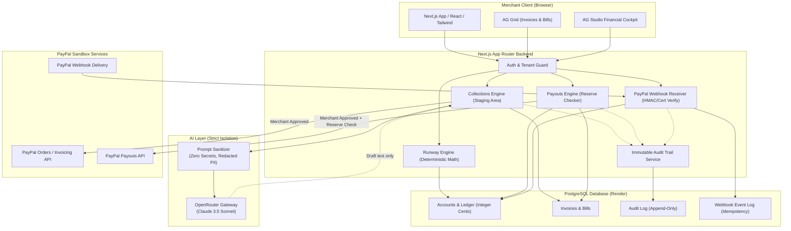
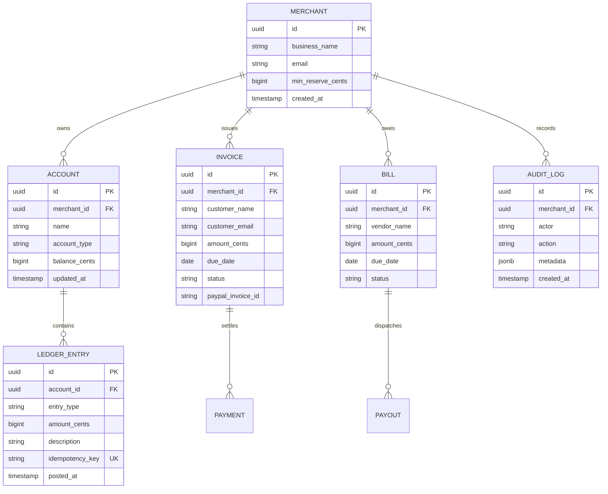

# System Architecture & Technical Design

## MerchOps AI — Financial Operations Copilot

> [!IMPORTANT]
> **Implementation Status (Milestone 5 Working Prototype)**:
> - **Runway Engine**: Implemented & verified via automated tests (100% deterministic integer cents).
> - **Collections Workflow**: Implemented (OpenRouter reminder drafting with honest fallback, staging drawer, payment simulation).
> - **Payouts Engine**: Implemented & verified (two-step approval, reserve floor guardrails, idempotency keys, strict Sandbox URL lockdown, simulation rail tested, live Sandbox dispatch unverified).
> - **Audit Trail**: Implemented in-memory demo repository with comprehensive action tagging.
> - **Persistence & Webhooks**: Currently runs on an in-memory repository for prototype evaluation; PostgreSQL persistence and live webhook verification are planned for production rollout.

---

## 1. High-Level Architecture

MerchOps AI uses a modular Next.js App Router architecture with strict security boundaries separating the AI reasoning engine, the deterministic financial core, the PostgreSQL ledger, and PayPal external services.

---

## 2. Core Modules

### 2.1 Runway Engine (Deterministic Cash Flow)
- **Principle**: Zero LLM involvement in arithmetic or forecasting.
- **Inputs**:
  - Current cleared cash balance (integer cents).
  - Confirmed receivables (invoices due within 30 days, weighted by payment probability).
  - Confirmed payables (bills due within 30 days).
  - Configured merchant safety reserve (`min_reserve_cents`).
- **Algorithm**:
  $$\text{Balance}(d) = \text{Balance}(d-1) + \text{Inflows}(d) - \text{Outflows}(d)$$
  Where $d \in [1, 30]$ days.
- **Breach Detection**: If $\min_{d \in [1, 30]} \text{Balance}(d) < \text{min\_reserve\_cents}$, trigger a **Reserve Breach Alert** indicating the exact date and projected deficit.

### 2.2 Collections Engine (Human-in-the-Loop AR)
- **Invoice Aging**: Categorizes unpaid invoices (Current, 1–15d, 16–30d, 30d+).
- **Drafting Workflow**:
  1. Overdue invoice is selected.
  2. Prompt Sanitizer packages only: customer name, invoice amount (formatted string), invoice date, due date, item description.
  3. OpenRouter generates a structured tone-appropriate reminder email.
  4. The draft is placed into an interactive **Staging Area**.
  5. The merchant can edit, discard, or approve the draft.
  6. Upon approval, the reminder is dispatched with a direct PayPal Sandbox payment link.

### 2.3 Payouts Engine (Reserve-Safe AP)
- **Liquidity Simulation**: Before scheduling any vendor payout:
  $$\text{Projected Min Balance} = \min_{d} \left(\text{Balance}(d) - \text{Payout Amount}\right)$$
  If $\text{Projected Min Balance} < \text{min\_reserve\_cents}$, the action is blocked or flagged with an explicit liquidity warning.
- **Two-Step Authorization**:
  - Merchant must review the payout details on a dedicated modal.
  - Merchant clicks "Authorize & Disburse".
  - Backend attaches a unique `Idempotency-Key` (UUIDv4) and calls PayPal Sandbox Payouts API.

---

## 3. Financial Integrity & Security Architecture

### 3.1 Integer Cents Representation
- All currency values across the system are stored and calculated as 64-bit integers (`BIGINT` in PostgreSQL).
- Example:
  - `$1.00` = `100` cents
  - `$10,500.50` = `1050050` cents
- Conversion to display strings happens strictly at the UI boundary using localized formatting functions.

### 3.2 Secret Isolation & Prompt Sanitization
- API keys, PayPal client secrets, and database connection strings exist exclusively in server-side environment variables.
- The AI context builder (`sanitizer.ts`) strips any sensitive credentials or irrelevant merchant data before calling OpenRouter.
- The AI has no tool or API capability to initiate network calls to PayPal or modify database records.

### 3.3 Webhook Verification & Replay Protection
- Inbound PayPal webhooks are posted to `/api/webhooks/paypal`.
- Verification flow:
  1. Extract headers: `paypal-auth-algo`, `paypal-cert-url`, `paypal-transmission-id`, `paypal-transmission-sig`, `paypal-transmission-time`.
  2. Verify webhook signature against PayPal Sandbox API verification endpoint.
  3. Query `webhook_events` table for `transmission_id`. If exists, return `200 OK` immediately (idempotent skip).
  4. If new, wrap ledger update and event record creation in a single PostgreSQL transaction.

### 3.4 Immutable Audit Logging
- Every critical event produces an append-only entry in `audit_logs`:
  - `actor_id` (User ID or 'SYSTEM')
  - `action` (`DRAFT_GENERATED`, `DRAFT_APPROVED`, `PAYMENT_RECEIVED`, `PAYOUT_REQUESTED`, `PAYOUT_EXECUTED`)
  - `entity_type` and `entity_id`
  - `payload_snapshot` (JSONB)
  - `created_at` (Timestamp)

---

## 4. Entity Relationship Model (Conceptual)

