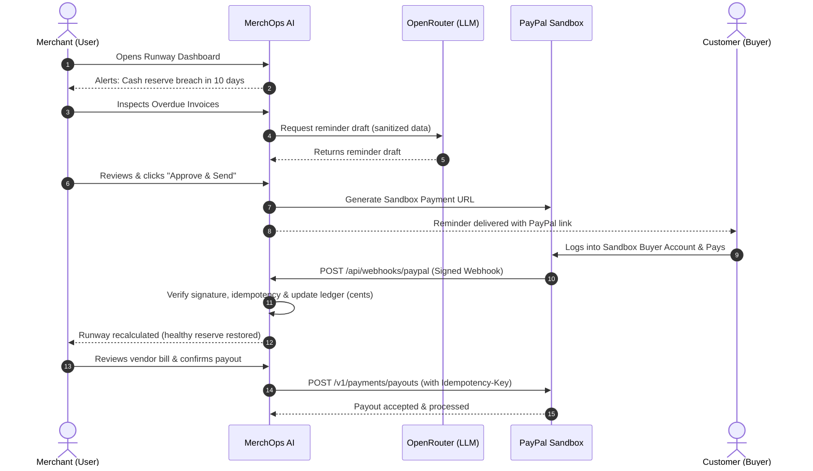

# PayPal Sandbox Setup & Testing Guide

## MerchOps AI — PayPal AI Hackathon 2026

This guide provides instructions for configuring, testing, and verifying the PayPal Developer Sandbox environment for MerchOps AI.

---

## 1. Verified Capabilities vs. Working Assumptions

In accordance with our financial and security rules, we explicitly distinguish between capabilities verified by standard PayPal developer documentation and assumptions that must be validated during sandbox integration.

### Verified Capabilities (Standard PayPal Developer Platform)
- **OAuth 2.0 Authentication**: Standard client credentials grant via `POST /v1/oauth2/token` returning short-lived bearer tokens.
- **Orders API v2**: Creating and capturing sandbox checkout orders for invoice payment (`POST /v2/checkout/orders`, `POST /v2/checkout/orders/{id}/capture`).
- **Invoicing API v2**: Creating drafts, sending invoices, and retrieving invoice payment URLs (`POST /v2/invoicing/invoices`).
- **Webhook Signature Verification**: Cryptographic validation endpoint (`POST /v1/notifications/verify-webhook-signature`) verifying transmission headers and CRC32/RSA signatures.
- **Sandbox Webhook Simulator**: Developer dashboard tool to dispatch synthetic webhook events (`PAYMENT.CAPTURE.COMPLETED`, `INVOICING.INVOICE.PAID`).

### Working Assumptions (To Be Confirmed During Sandbox Testing)
- **Assumption 1 (Payouts API Sandbox Enablement)**: We assume that the PayPal Sandbox default business account has the Payouts API (`POST /v1/payments/payouts`) enabled by default. *Mitigation*: If sandbox payouts return `INSUFFICIENT_FUNDS` or `FEATURE_NOT_AVAILABLE`, verify account wallet balance and permissions in the developer portal, or simulate the final payout dispatch with mock mode fallback. The mock payout fallback is strictly a simulation and never executes a real PayPal transaction.
- **Assumption 2 (Webhook Delivery Latency)**: We assume standard sandbox webhooks arrive within 2–5 seconds during live demo runs. *Mitigation*: Support both automated webhook updates and a manual "Sync with PayPal" fallback button in the UI for the live demo.
- **Assumption 3 (Multi-Currency Sandbox Testing)**: We assume all transactions for this hackathon demo are in `USD`. Multi-currency conversion is out of scope for the MVP.

### Pending Sandbox Verification Tests

The following integration verification tests have not yet been executed in application code. All tests remain pending:

- [ ] Confirm Sandbox Business and Personal accounts are available.
- [ ] Create a Sandbox REST application and obtain credentials.
- [ ] Obtain an OAuth access token successfully.
- [ ] Verify whether the Payouts API is enabled.
- [ ] Test `POST /v1/payments/payouts` and record the actual HTTP status and response.
- [ ] Verify payout status and recipient-side results.
- [ ] Configure a webhook and verify actual delivery.
- [ ] Test webhook signature verification using the raw request body in Next.js.
- [ ] Test duplicate webhook delivery and confirm safe deduplication.
- [ ] Record all results as VERIFIED, DOCUMENTED, ASSUMED, or UNVERIFIED.

---

## 2. Sandbox Setup Instructions

### Step 1: Create Developer Accounts
1. Log in to the [PayPal Developer Dashboard](https://developer.paypal.com/).
2. Navigate to **Testing Tools** > **Sandbox Accounts**.
3. Create two sandbox accounts:
   - **Merchant Account** (Business Type): Represents the MerchOps AI merchant user.
   - **Customer Account** (Personal Type): Represents the customer paying overdue invoices.

### Step 2: Create a REST API App
1. Go to **Apps & Credentials** > select **Sandbox** mode.
2. Click **Create App**:
   - App Name: `MerchOps-AI-Dev`
   - App Type: `Merchant`
   - Link to your sandbox Merchant Account.
3. Note the generated credentials:
   - **Client ID**
   - **Client Secret**

### Step 3: Configure Environment Variables
Copy these values into your `.env.local` file (derived from `.env.example`):

```bash
PAYPAL_API_BASE_URL=https://api-m.sandbox.paypal.com
PAYPAL_CLIENT_ID=your_sandbox_client_id_here
PAYPAL_CLIENT_SECRET=your_sandbox_client_secret_here
```

### Step 4: Configure Webhooks
1. In your PayPal App settings, scroll to **Sandbox Webhooks** and click **Add Webhook**.
2. **Webhook URL**: Use your local tunnel URL (via ngrok/localtunnel) or deployed Render URL:
   ```text
   https://<your-subdomain>.ngrok-free.app/api/webhooks/paypal
   ```
3. Subscribe to the following event types:
   - `PAYMENT.CAPTURE.COMPLETED`
   - `INVOICING.INVOICE.PAID`
   - `PAYMENT.PAYOUTSBATCH.SUCCESS`
4. Copy the resulting **Webhook ID** into `.env.local`:
   ```bash
   PAYPAL_WEBHOOK_ID=your_webhook_id_here
   ```

---

## 3. End-to-End Demo Simulation Script

Use these steps to test the full hackathon demo story in Sandbox mode:



---

## 4. Troubleshooting Sandbox Issues

| Issue | Likely Cause | Resolution |
|---|---|---|
| `401 Unauthorized` | Invalid Client ID/Secret or expired token | Check `.env.local` credentials and verify OAuth token generator cache. |
| Webhook verification fails | Incorrect `PAYPAL_WEBHOOK_ID` or modified raw body | Ensure Next.js route uses `req.text()` for raw body before JSON parsing. |
| Payout rejected | Insufficient funds in sandbox merchant balance | Add funds to Sandbox Merchant account balance in the Developer Dashboard. |

