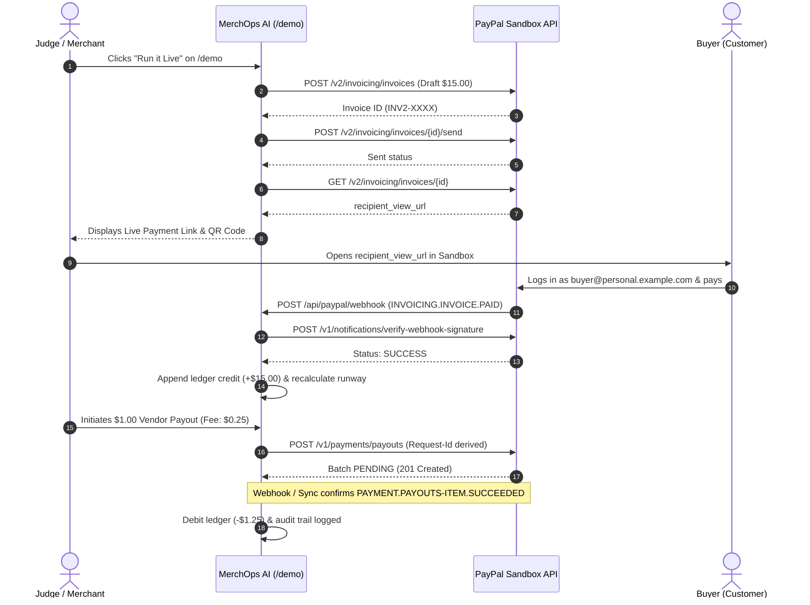

# PayPal Sandbox Setup & Testing Guide

## MerchOps AI — PayPal AI Hackathon 2026

This guide explains how to configure the PayPal Developer Sandbox for MerchOps AI, test live Invoicing v2 and Payouts rails, verify webhooks, and run automated diagnostics.

---

## 1. Verified Architecture & Capability Status

In accordance with our financial and security rules, we separate documented external platform behavior from verified codebase capabilities.

| Rail / Capability | Status | Implementation Details |
|---|---|---|
| **OAuth 2.0 Token Cache** | **[VERIFIED]** | Client Credentials grant (`POST /v1/oauth2/token`) with in-memory caching and proactive expiry refresh (`src/lib/paypal.ts`). Origin locked strictly to `https://api-m.sandbox.paypal.com`. |
| **Invoicing v2 Draft** | **[VERIFIED]** | `POST /v2/invoicing/invoices` creates full merchant invoices in integer cents (`src/lib/paypalInvoicing.ts`). |
| **Invoicing v2 Send & Pay Link** | **[VERIFIED]** | `POST /v2/invoicing/invoices/{id}/send` triggers delivery, and `GET /v2/invoicing/invoices/{id}` extracts `recipient_view_url` for live customer checkout. |
| **Invoicing v2 Remind** | **[VERIFIED]** | `POST /v2/invoicing/invoices/{id}/remind` delivers AI-proposed, merchant-approved reminders via official PayPal notification channels. |
| **Invoicing v2 QR Code & Cancel** | **[VERIFIED]** | `POST /v2/invoicing/invoices/{id}/generate-qr-code` for point-of-sale checkout; `POST /v2/invoicing/invoices/{id}/cancel` for revoking unpaid invoices. |
| **Fee-Inclusive Payouts** | **[VERIFIED]** | US Domestic 2% fee schedule (min $0.25, max $1.00 USD) calculated upfront via `calculatePayoutFeeCents` (`src/lib/money.ts`). Reserve floor checks evaluate `amount + fee` before approving disbursements. |
| **Two-Step Payout Authorization** | **[VERIFIED]** | Modal confirmation requiring explicit checkbox agreement (`confirmed: true`); server rejects unconfirmed payout requests. |
| **Deterministic Idempotency** | **[VERIFIED]** | `PayPal-Request-Id` derived deterministically from `(bill_id, action, attempt)` — never random UUIDs. Prevents duplicate disbursements across retries. |
| **Webhook Cryptographic Verification**| **[VERIFIED]** | Inbound payloads validated against PayPal certificate via `POST /v1/notifications/verify-webhook-signature`. Replays deduped via PostgreSQL `webhook_events(event_id UNIQUE)`. |
| **Advisory Locks on Concurrency** | **[VERIFIED]** | PostgreSQL transactional advisory locks (`pg_advisory_xact_lock(hashtext(bill_id))`) prevent race conditions from simultaneous approvals. |
| **Negative Mock Testing** | **[VERIFIED]** | Tested with `PayPal-Mock-Response` headers (`INSUFFICIENT_FUNDS`, `RECEIVER_UNREGISTERED`). |

---

## 2. Sandbox Setup Instructions

### Step 1: Sandbox Accounts
1. Log in to [PayPal Developer Dashboard](https://developer.paypal.com/).
2. Under **Testing Tools** > **Sandbox Accounts**:
   - **Merchant Account** (Business Type): Serves as the MerchOps seller receiving collections and disbursing payments.
   - **Customer Account** (Personal Type): e.g. `buyer@personal.example.com` (used by judges to pay invoices).
   - **Vendor Account** (Personal Type): e.g. `vendor@personal.example.com` (receives payout items).

### Step 2: REST App Credentials
1. Go to **Apps & Credentials** > Sandbox.
2. Select your app (or create `MerchOps-AI` with Payouts & Invoicing enabled).
3. Copy your `Client ID` and `Client Secret`.

### Step 3: Configure `.env.local`
```bash
cp .env.example .env.local
```
Add your credentials:
```bash
DEMO_AS_OF=2026-11-03
PAYPAL_API_BASE_URL="https://api-m.sandbox.paypal.com"
PAYPAL_CLIENT_ID="<your_sandbox_client_id>"
PAYPAL_CLIENT_SECRET="<your_sandbox_client_secret>"
PAYPAL_PAYOUTS_ENABLED=true
PAYPAL_WEBHOOK_ID="<your_sandbox_webhook_id>"
OPENROUTER_API_KEY="<your_openrouter_api_key>"
DATABASE_URL="postgres://..." # Optional: local or Render Postgres
```

---

## 3. Diagnostic & Setup Tooling (`scripts/`)

We provide lightweight, self-contained ESM diagnostic scripts that read credentials safely from `.env` or `.env.local`, never print sensitive secrets, and exit with code `0` on success or non-zero on failure.

### 1. Token Verification: `scripts/paypal-token.mjs`
Authenticates against PayPal Sandbox and verifies token issuance:
```bash
node scripts/paypal-token.mjs
```

### 2. Deep Sandbox Health Check: `scripts/sandbox-check.mjs`
Checks OAuth token, account profile, and exercises draft invoice creation:
```bash
node scripts/sandbox-check.mjs
# Deep mode: creates and verifies a $1.00 test draft invoice
node scripts/sandbox-check.mjs --deep
```

### 3. Automated Webhook Registration: `scripts/register-webhook.mjs`
Registers `POST /api/paypal/webhook` on your public deployment URL (e.g., Render) for all critical events (`INVOICING.INVOICE.PAID`, `PAYMENT.PAYOUTS-ITEM.SUCCEEDED`, etc.):
```bash
node scripts/register-webhook.mjs https://merchops-ai.onrender.com/api/paypal/webhook
```

### 4. AI Gateway Health Check: `scripts/ai-check.mjs`
Verifies OpenRouter connectivity, fallback behavior, and token cap:
```bash
node scripts/ai-check.mjs
```

### 5. PostgreSQL Migration Runner: `scripts/migrate.mjs`
Runs all SQL migrations (`001_init.sql` through `004_ai_proposals.sql`) idempotently:
```bash
node scripts/migrate.mjs
```

---

## 4. End-to-End Live Verification Sequence



---

## 5. Negative Testing & Mock Responses

MerchOps AI supports PayPal negative testing headers (`PayPal-Mock-Response`) to verify fault tolerance:

- `{"mock_application_codes":"INSUFFICIENT_FUNDS"}`: UI displays actionable error message without debiting the ledger.
- `{"mock_application_codes":"RECEIVER_UNREGISTERED"}`: Payout is held in `FAILED` state, cash reserve is released back to merchant balance.
- Signature mismatch: Webhook endpoint rejects forged payloads with HTTP 400 without touching ledger entries.
