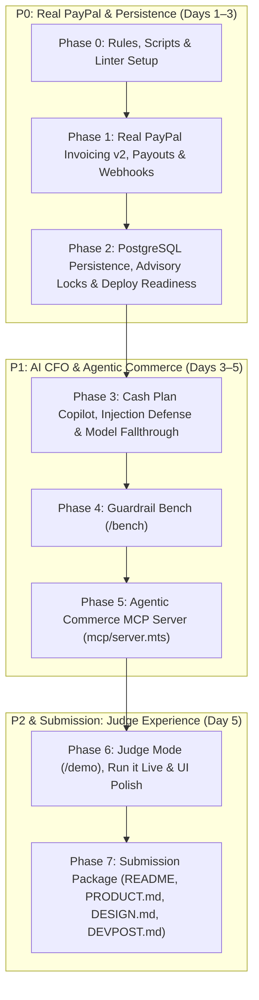

# MerchOps AI — Upgrade Plan & Production Roadmap

> **Target**: Upgrade MerchOps AI from a verified simulation prototype to a live, verified, deployed, judge-ready PayPal + AI product for the **PayPal AI Hackathon 2026**.  
> **Deadline**: Nov 12, 2026, 12:00 PM PST (Nov 13, 1:30 AM IST).  
> **Core Principle**: *"AI proposes, rules decide. AI must never independently move money."*

---

## 1. Executive Summary & Goals

MerchOps AI currently features a verified integer-cent runway forecast engine, a reserve-floor guardrail ($2,000.00), a two-step payout confirmation flow, and in-memory audit logging. However, external PayPal interactions are currently marked `UNVERIFIED` / `NOT IMPLEMENTED`, data is held in-memory, and the AI layer is limited to an email reminder generator.

To compete and win across all five judging criteria (**Technological Implementation, Design, Potential Impact, Innovation, Presentation**), this upgrade executes three major phases:
1. **P0: Real PayPal Rail & Persistence** — Replace simulated links with live PayPal Invoicing v2, live PayPal Payouts with fee-inclusive reserve checks, cryptographic webhook signature verification, and PostgreSQL append-only persistence.
2. **P1: AI CFO Guardrail Engine & Agentic Commerce** — Introduce the **Cash Plan Copilot** (AI proposes structured actions, deterministic code validates and simulates), prompt injection defense, the **Guardrail Bench** (`/bench`), and a Model Context Protocol (**MCP**) server for agentic commerce.
3. **P1/P2: Judge Experience & Submission Package** — Guided judge tour (`/demo`), 1-click "Run it live" sandbox test, showcase strip of verified runs, full `PRODUCT.md` / `DESIGN.md` in Milestone format, and `DEVPOST.md` with demo video script.

---

## 2. Non-Negotiable Operational & Financial Rules

1. **AI Never Moves Money**: Model outputs are strictly proposals (`ai_proposals`). Only deterministic server code applies financial policy and executes PayPal API mutations. Model tools (including MCP) are strictly read-only or propose-only.
2. **Deterministic `PayPal-Request-Id`**: Every money-moving or outbound POST generates a deterministic idempotency key derived from `(entity_id, action[, attempt])`. We fix the stale reference to random UUIDv4 in `AGENTS.md` Rule 6.
3. **Integer Cents Throughout**: All currency is stored in PostgreSQL as `BIGINT` and represented in code as integer cents. Decimal strings (`"300.00"`) are used strictly at the PayPal API boundary and formatted strings at the UI presentation boundary.
4. **PayPal IDs Preserved**: Every entity stores its external PayPal identifiers (`invoice_id`, `invoice_number`, `recipient_view_url`, `payout_batch_id`, `payout_item_id`, `transaction_id`, `webhook_event_id`).
5. **Append-Only Auditing**: Every state change inserts an audit row with actor (`MERCHANT | SYSTEM | PAYPAL_WEBHOOK | AI_PROPOSAL`), `before_state`, `after_state`, and `paypal_debug_id`. A PostgreSQL database trigger enforces immutability by rejecting `UPDATE` and `DELETE`.
6. **Cryptographic Webhook Signature Verification**: Every inbound webhook is verified via `POST /v1/notifications/verify-webhook-signature`. Handlers are strictly idempotent using `webhook_events(event_id UNIQUE)` and tolerant of out-of-order events.
7. **Sandbox Origin Lockdown**: Hardcoded enforcement of `https://api-m.sandbox.paypal.com`. Any other host is rejected before network requests are dispatched.
8. **Radical Honesty**: Every capability claim in `README.md` and `docs/SANDBOX_GUIDE.md` is tagged `[VERIFIED]` (with date and real sandbox IDs), `[DOCS]`, or `[SIMULATED]`. Offline simulations remain available under a designated toggle.
9. **User Permission for External Side Effects**: Before registering live webhooks, provisioning external databases (Neon/Render), or deploying, explicit user approval is requested.
10. **Zero Secrets in Code/Logs**: Never read `.env` or print tokens. Scripts source `.env.local` safely.

---

## 3. Phased Implementation Roadmap

---

### Phase 0: Baseline Fixes, Rules & Sandbox Scripting
- **AGENTS.md Fixes**:
  - Update Rule 6 to specify deterministic `PayPal-Request-Id` derived from `(entity_id, action[, attempt])`.
  - Update dev environment metadata to reflect current cross-platform support.
- **Linter & Tooling**:
  - Add ESLint configuration (`eslint.config.mjs`) compatible with Next.js 15 so `npm run lint` executes non-interactively and passes.
  - Port sandbox CLI scripts into `merchops-ai/scripts/` (Node.js & bash/powershell cross-platform):
    - `scripts/paypal-token.mjs` (fetches OAuth token, checks scopes, outputs status without leaking secrets)
    - `scripts/sandbox-check.mjs` (read-only diagnostic, tests Invoicing, Payouts, Webhook verification endpoints; supports `--deep`)
    - `scripts/register-webhook.mjs` (idempotently registers webhook URL on PayPal Sandbox)
    - `scripts/ai-check.mjs` (verifies OpenRouter free model connectivity and fallthrough)

---

### Phase 1: P0 — Make PayPal Real (Collections & Payouts Rail)
- **Typed PayPal REST Client (`src/lib/paypal/`)**:
  - `client.ts`: Unified authenticated request wrapper with automatic token caching and expiration handling.
  - `invoicing.ts`:
    - `createDraftInvoice(invoiceData)`: `POST /v2/invoicing/invoices`
    - `sendInvoice(invoiceId)`: `POST /v2/invoicing/invoices/{id}/send`
    - `getInvoice(invoiceId)`: `GET /v2/invoicing/invoices/{id}` (extracts `recipient_view_url`)
    - `remindInvoice(invoiceId, note, subject)`: `POST /v2/invoicing/invoices/{id}/remind`
    - `cancelInvoice(invoiceId, reason)`: `POST /v2/invoicing/invoices/{id}/cancel`
    - `generateQrCode(invoiceId)`: `POST /v2/invoicing/invoices/{id}/generate-qr-code`
    - `recordPayment(invoiceId, paymentDetails)`: `POST /v2/invoicing/invoices/{id}/payments`
  - `payouts.ts`:
    - `createPayoutBatch(items, idempotencyKey)`: `POST /v1/payments/payouts`
    - `getPayoutBatch(batchId)`: `GET /v1/payments/payouts/{batch_id}`
    - `getPayoutItem(itemId)`: `GET /v1/payments/payouts-item/{item_id}`
  - `webhooks.ts`:
    - `verifyWebhookSignature(headers, rawBody, webhookId)`: `POST /v1/notifications/verify-webhook-signature`
  - `errors.ts`: Typed error parser extracting PayPal debug IDs, issue codes, and user-facing remediation.
- **Collections Flow Upgrade**:
  - Replace fake `https://sandbox.paypal.com/checkout/simulate/...` with real PayPal sandbox invoice URLs.
  - UI action: Merchant approves AI draft reminder -> calls `/v2/invoicing/invoices/{id}/remind` using the merchant-approved text.
  - Webhook listener: `/api/webhooks/paypal` receives `INVOICING.INVOICE.PAID` and `PAYMENT.CAPTURE.COMPLETED`:
    - Verifies cryptographic signature.
    - Idempotently marks invoice `PAID`, appends ledger credit, and triggers runway recomputation.
  - Manual sync fallback: `POST /api/invoices/sync` to reconcile status if webhook experiences network latency.
- **Payouts Rail Upgrade**:
  - Incorporate real PayPal fee calculation (2%, max $1.00 USD for domestic payouts).
  - Safety reserve policy check includes the payout fee: `Projected Balance = Balance - Amount - Fee >= Safety Reserve`.
  - Handle webhook events: `PAYMENT.PAYOUTS-ITEM.SUCCEEDED`, `FAILED`, `UNCLAIMED`, `RETURNED`, `BLOCKED`.
  - Negative testing scenarios: Support `PayPal-Mock-Response` headers (e.g., `INSUFFICIENT_FUNDS`, `RECEIVER_UNREGISTERED`) with graceful UI recovery.
- **Tests to Add**:
  - Invoicing payload builders & status transitions.
  - Fee-inclusive reserve check test.
  - Webhook signature verification and deduplication test.
  - Live sandbox E2E test script (`npm run sandbox:e2e`).

---

### Phase 2: P0 — Persistence & Database Layer (PostgreSQL)
- **Database Schema (`db/migrations/`)**:
  - `001_init.sql`:
    - `merchants` (id, business_name, email, min_reserve_cents, created_at)
    - `invoices` (id, merchant_id, invoice_number, customer_name, customer_email, amount_cents, due_date, status, paypal_invoice_id, recipient_view_url, created_at)
    - `bills` (id, merchant_id, bill_number, vendor_name, vendor_email, amount_cents, due_date, status, created_at)
    - `payouts` (id, merchant_id, bill_id, request_id UNIQUE, batch_id, item_id, amount_cents, fee_cents, status, created_at)
    - `ledger_entries` (id, merchant_id, entry_type, amount_cents, reference_type, reference_id, created_at) — strictly append-only; balance is `SUM(amount_cents)`
  - `002_webhook_events.sql`:
    - `webhook_events` (event_id PRIMARY KEY, event_type, resource_type, summary, payload JSONB, verified_at, processed_at)
  - `003_audit_triggers.sql`:
    - `audit_logs` (id, merchant_id, actor, action, details, amount_cents, paypal_debug_id, metadata JSONB, created_at)
    - Trigger enforcing append-only behavior (rejects `UPDATE` and `DELETE` on `audit_logs` and `ledger_entries`).
  - `004_ai_proposals.sql`:
    - `ai_proposals` (id, merchant_id, prompt_hash, model, proposal_json JSONB, status, decided_by, decided_at, created_at)
    - `rate_limits` (key, count, reset_at)
- **Repository Abstraction (`src/lib/repository/`)**:
  - Define `IRepository` interface.
  - Implement `PgRepository` backed by `pg` connection pool.
  - Concurrency control: Postgres transaction advisory lock `pg_advisory_xact_lock(hashtext(bill_id))` during payout authorization to prevent concurrent double-spend.
  - Seed script and migrations runner (`scripts/migrate.ts`).
  - Fallback in-memory adapter retained for offline development/demos.
- **Deployment & Production Hardening**:
  - Add `/api/health` returning `{ ok: true, commit: string, db: "up" | "memory" }`.
  - Production guards: simulate buttons disabled in production unless `ALLOW_DEV_ACTIONS=1`.
  - Reset endpoint protected by `DEMO_ADMIN_TOKEN`.

---

### Phase 3: P1 — AI CFO: Cash Plan Copilot & Guardrail Bench
- **Robust Model Layer (`src/lib/ai/`)**:
  - OpenRouter client querying free tier models dynamically (`curl -s https://openrouter.ai/api/v1/models`).
  - Environment-configured fallback list: `AI_MODEL`, `AI_MODEL_FALLBACK`, `AI_MODEL_FALLBACK_2`.
  - Automatic fallthrough on 404 / 429 / 5xx / timeout.
  - Daily token cap enforcement (`AI_DAILY_CAP`) and deterministic prompt hashing for verdict caching in `ai_proposals`.
  - Grounding check: Narrative texts must use placeholders like `{{runway.minBalance}}`. Strip or reject ungrounded figures.
  - Prompt injection defense: Spotlight untrusted user fields (customer notes, invoice descriptions) using delimiters and injection detection checks (`src/lib/ai/spotlight.ts`).
- **Cash Plan Copilot (`src/lib/plan/`)**:
  - Input: Current cleared cash, 30-day runway projection, open invoices with payment risk history, upcoming bills with vendor terms.
  - Output: Three alternative structured plans:
    1. **"Safest"**: Maximize reserve buffer; defer non-urgent payables.
    2. **"Fastest Cash"**: Aggressively chase overdue invoices and offer early-payment discounts.
    3. **"Lowest Cost"**: Avoid all late fees while staying strictly above the reserve floor.
  - Closed Action Enum: `CHASE_INVOICE`, `SEND_INVOICE_REMINDER`, `OFFER_EARLY_PAY_DISCOUNT`, `SCHEDULE_BILL`, `SPLIT_BILL`, `DEFER_BILL`, `HOLD_PAYOUT`.
  - **Deterministic Plan Validator (`src/lib/plan/validate.ts`)**:
    - Validates all entity IDs exist.
    - Recalculates all arithmetic and dates deterministically in code (zero model-generated numbers trusted).
    - Runs runway simulation: Rejects plan if any day breaches safety reserve or exceeds bill grace period.
    - Outputs pass/fail verdict with exact rules cited.
- **Collections Intelligence**:
  - Deterministic payment-risk score per customer (days overdue, historical payment timeliness, invoice size).
  - Seeded malicious invoice description in demo dataset to demonstrate prompt-injection trap being flagged.
- **Guardrail Bench (`/bench`)**:
  - 12–20 seeded stress scenarios (reserve breach disguised by fees, duplicate vendor bill, prompt injection in bill memo, altered vendor payout email, fake payment confirmation).
  - Head-to-head comparison: LLM-only approver vs. MerchOps Guardrailed Engine.
  - Metrics: Unsafe payouts approved, reserve breaches, prompt injection vulnerabilities exploited.
  - Static committed baseline results for instant page rendering without burning live API tokens.

---

### Phase 4: P1 — Agentic Commerce (MCP Server)
- **Model Context Protocol Server (`mcp/server.mts`)**:
  - Built with `@modelcontextprotocol/sdk`.
  - **Read Tools**:
    - `get_runway`: Returns current cash, reserve floor, and 30-day trajectory.
    - `list_invoices`: Returns unpaid/overdue customer invoices with risk scores.
    - `list_bills`: Returns upcoming bills and liquidity status.
    - `get_audit_trail`: Retrieves recent immutable audit logs.
  - **Propose-Only Tools**:
    - `propose_cash_plan`: Submits candidate action plan to deterministic validator.
    - `draft_reminder`: Drafts context-aware invoice reminder.
    - `stage_invoice`: Creates a `DRAFT` invoice on PayPal (never dispatches or moves funds).
  - **Strict Security Guardrail**:
    - Zero money-moving tools (`send_payout`, `pay_bill`, `cancel_invoice`) exist in the MCP server.
    - Every proposal is queued for merchant interactive review in the MerchOps UI.

---

### Phase 5: Judge Experience & UI Polish
- **Judge Tour & Mode (`/demo`)**:
  - Guided interactive tour component (`DemoTour`) at bottom right, fully responsive down to 390px mobile viewports.
  - **"Run it live" flow**:
    - 1-Click: Creates a real PayPal Sandbox invoice.
    - Click: Opens real sandbox pay URL; judge pays with provided test customer credentials.
    - Auto-detect: Webhook arrives, marks invoice paid, runway flips from red to green in real time.
    - 1-Click: Authorizes real $1.00 vendor payout; monitors batch and item ID reaching `SUCCESS`.
    - Real PayPal IDs displayed in monospace with copy buttons.
  - Showcase strip of verified historical runs with live PayPal transaction and batch IDs.
  - Multiple seeded scenarios: Retail Shop ($4,200 baseline), Freelance Agency, Café.
- **Product & Design Artifacts**:
  - `PRODUCT.md`: Problem statement, target personas, positioning, competitive moat, accessibility standards.
  - `DESIGN.md`: Design system tokens, color semantics, typography, AG Grid custom styling rules.
  - WCAG 2.2 AA compliance, visible focus states, `prefers-reduced-motion` support.

---

### Phase 6: Submission Package & Final Verification
- **Documentation**:
  - Full `README.md` overhaul with 30-second Judge's Path, verified status matrix, system architecture diagram, and sandbox test account logins.
  - `docs/DEVPOST.md`: Complete Devpost pitch text, judges' scoring alignment, and <3 minute video walkthrough script.
  - Update `docs/SANDBOX_GUIDE.md` with verified execution logs, timestamps, and PayPal IDs.
- **Verification Gates**:
  - `npm run lint` — 0 errors.
  - `npm run typecheck` — 0 errors.
  - `npm test` — all unit, concurrency, and guardrail tests pass.
  - `npm run build` — clean Next.js production build.
  - Verification of APIMatic SDK integration requirements (`paypal-plan.md` contract sheet).

---

## 4. File-Level Change Map

| File Path | Action | Description |
|---|---|---|
| `AGENTS.md` | **Modify** | Fix Rule 6 (deterministic `PayPal-Request-Id`), update OS environment description |
| `eslint.config.mjs` | **Create** | Next.js 15 flat ESLint configuration for non-interactive linting |
| `scripts/paypal-token.mjs` | **Create** | Diagnostic tool for testing OAuth client credentials & scopes |
| `scripts/sandbox-check.mjs` | **Create** | Read-only PayPal Sandbox endpoint diagnostic (`--deep` mode) |
| `scripts/register-webhook.mjs` | **Create** | Idempotent PayPal Sandbox webhook registration tool |
| `scripts/ai-check.mjs` | **Create** | OpenRouter free model availability and fallback validation |
| `src/lib/paypal/client.ts` | **Create** | Authenticated PayPal REST client with token caching & origin lockdown |
| `src/lib/paypal/invoicing.ts` | **Create** | PayPal Invoicing v2 draft, send, remind, cancel, QR, payment recording |
| `src/lib/paypal/payouts.ts` | **Create** | PayPal Payouts v1 dispatch, batch/item status polling, fee calculation |
| `src/lib/paypal/webhooks.ts` | **Create** | Cryptographic webhook signature verification via PayPal API |
| `src/lib/paypal/errors.ts` | **Create** | Structured error parser for PayPal API rejection responses |
| `src/app/api/webhooks/paypal/route.ts` | **Create** | Inbound webhook route verifying signature & idempotently settling ledger |
| `src/app/api/invoices/create/route.ts` | **Create** | Create real PayPal sandbox invoice |
| `src/app/api/invoices/send/route.ts` | **Create** | Send invoice and retrieve `recipient_view_url` |
| `src/app/api/invoices/sync/route.ts` | **Create** | Fallback polling route for syncing invoice status |
| `src/app/api/payouts/authorize/route.ts` | **Modify** | Add fee-inclusive reserve check, deterministic request ID, batch item tracking |
| `src/app/api/health/route.ts` | **Create** | Health probe `{ ok, commit, db }` |
| `db/migrations/001_init.sql` | **Create** | Core tables (merchants, invoices, bills, payouts, append-only ledger) |
| `db/migrations/002_webhook_events.sql` | **Create** | Webhook deduplication log |
| `db/migrations/003_audit_triggers.sql` | **Create** | Immutable append-only trigger for audit logs and ledger |
| `db/migrations/004_ai_proposals.sql` | **Create** | AI proposal cache and rate-limiting tables |
| `src/lib/repository/interface.ts` | **Create** | Abstract repository contract |
| `src/lib/repository/memory.ts` | **Create** | In-memory repository implementation (updated from `store.ts`) |
| `src/lib/repository/postgres.ts` | **Create** | PostgreSQL repository implementation with transaction advisory locks |
| `src/lib/ai/client.ts` | **Create** | OpenRouter client with dynamic free model fallback and daily cap |
| `src/lib/ai/spotlight.ts` | **Create** | Prompt injection defense, untrusted content delimiting & sanitization |
| `src/lib/plan/validate.ts` | **Create** | Deterministic Cash Plan validator and runway simulation checker |
| `src/app/api/ai/propose-plan/route.ts` | **Create** | AI Cash Plan Copilot endpoint returning 3 validated plans |
| `src/app/bench/page.tsx` | **Create** | Guardrail Bench page comparing LLM-only vs. MerchOps guardrails |
| `mcp/server.mts` | **Create** | Model Context Protocol server exposing read and propose-only tools |
| `src/components/demo/DemoTour.tsx` | **Create** | Guided judge tour panel |
| `src/components/demo/RunLiveModal.tsx` | **Create** | 1-click live sandbox invoice payment & payout verification flow |
| `src/app/demo/page.tsx` | **Create** | Dedicated Judge Mode page |
| `PRODUCT.md` | **Create** | Comprehensive product document (Milestone format) |
| `DESIGN.md` | **Create** | Design system and AG Grid specification (Milestone format) |
| `docs/DEVPOST.md` | **Create** | Hackathon submission writeup & 3-minute video recording script |
| `docs/SANDBOX_GUIDE.md` | **Modify** | Record all verified sandbox runs, timestamps, and PayPal IDs |
| `README.md` | **Modify** | Comprehensive judge-first overhaul with 30s quick path & verified matrix |

---

## 5. Risk Assessment & Mitigations

| Risk | Severity | Mitigation Strategy |
|---|---|---|
| **PayPal Sandbox Latency or Downtime** | Medium | Provide dual rails: real PayPal Sandbox execution as primary; fully labelled simulation mode as instant offline backup. Add manual "Sync with PayPal" button if webhooks lag. |
| **OpenRouter Free Model Rate Limits (429) or Model Deprecation** | Medium | Implement automatic three-model fallthrough (`AI_MODEL` -> `AI_MODEL_FALLBACK` -> `AI_MODEL_FALLBACK_2`). If all fail, display clear "AI busy, retry" message while deterministic template engine remains functional. |
| **Concurrent Double-Spend in Payouts** | High | Use Postgres transaction-level advisory locks (`pg_advisory_xact_lock(hashtext(bill_id))`) ensuring only one payout transaction per bill can execute simultaneously. Verify with automated 20-thread concurrency test. |
| **Prompt Injection via Customer Invoice Fields** | High | Apply delimiter tags and strict prompt sanitization before model inference. Model output is never executed directly; deterministic validator validates every field. |
| **Accidental Production Fund Movement** | Critical | Strict sandbox origin lockdown (`https://api-m.sandbox.paypal.com`). Hard error on any non-sandbox endpoint before requests leave server. |

---

## 6. Items Requiring User Input & Decisions

Before executing external side effects, the following items will be confirmed with the user:
1. **PayPal Sandbox App**:
   - Reuse verified `hackathon2` app credentials, or generate a dedicated sandbox app for MerchOps AI?
2. **Sandbox Test Accounts**:
   - Merchant account (seller): sandbox business email.
   - Customer account (buyer): sandbox personal email (e.g. `buyer@personal.example.com`).
   - Vendor account (receiver): sandbox personal email (e.g. `vendor@personal.example.com`).
3. **Database & Deployment Target**:
   - Preferred deployment platform: **Render** (free web service + managed Postgres) or **Vercel** + **Neon** (serverless Postgres)?
4. **Webhook Registration**:
   - Confirmation before registering the live webhook endpoint with PayPal Developer Sandbox.

